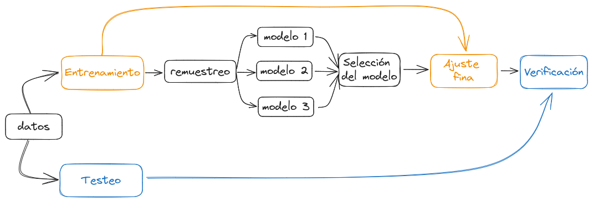

```{r}
library(tidyverse)
library(tidymodels)
# library(printr)

theme_set(theme_minimal())
```


## ¿Porqué tidymodels?

Tidymodels es en realidad un conjunto de paquetes de R que, al igual que Tidyverse, busca unificar la sintaxis y modo de uso al alrededor del modelado estadístico de datos. A diferencia de Tidyverse, Tidymodels no implementa nuevas maneras de, por ejemplo, aplicar el modelo lineal, si no que genera una interfaz única a partir de la cual utilizar las funciones que ya existen. De la misma manera, la salida que genera es consistente a lo largo de distintos modelos e implementaciones, y mejor aún en formato tidy.


## Los principales paquete de Tidymodels

|                                                  |                                                                 |                                                                  |
|-----------|------------------------------------------------------|-------|
| [`rsample`](https://rsample.tidymodels.org/)     | Para dividir y hacer remuestreo de los datos                    | {width="50"}   |
| [`recipes`](https://recipes.tidymodels.org/)     | Preprocesamiento de los datos de manera ordenada y reproducible | {width="50"}   |
| [`parsnip`](https://parsnip.tidymodels.org/)     | Interfaz unificada para modelar datos                           | {width="50"}   |
| [`workflows`](https://workflows.tidymodels.org/) | Organiza el preprocesamiento, el modelado y postprocesa         | {width="50"} |
| [`yardstick`](https://yardstick.tidymodels.org/) | Mide la efectividad de los modelos                              | {width="50"} |
| [`broom`](https://broom.tidymodels.org/)         | Resume la salida de modelos en formato tidy                     | {width="50"}     |

pero hay muchos otros con objetivos específicos que completan el universo de tidymodels.


## El proceso de modelado de datos

::: {.incremental}
-   **Cómo aprovechar los datos:** es importante hacer un "presupuesto" para planificar cómo vamos a usar los datos. Necesitamos dividir los datos en (al menos) entrenamiento y testeo. Usaremos `rsample` para esta tarea.

-   **Qué modelo utilizar:** la mayoría de las veces no sabremos cual es el mejor modelo a aplicar, dependerá en parte de nuestro objetivo: queremos hacer describir, hacer inferencias o predecir a partir de los datos? 

-   **La verificación:** es importante hacer una verificación tanto cualitativa (visual) como cuantitativa con los el subset de testeo, pero nunca con los datos de entrenamiento!
:::

## El proceso de modelado



## Datos de cultivos

```{r}
#| echo: true

cultivos <- read_csv("https://raw.githubusercontent.com/paocorrales/intro-tidymodels-agro/main/datos/cultivos.csv")
head(cultivos)  %>%
  gt::gt()
```

## La variable a predecir: `aceite_porcentaje`


```{r}
#| echo: true
#| message: FALSE
#| warning: FALSE

cultivos %>% 
  ggplot(aes(aceite_porcentaje)) +
  geom_histogram(color = "white") +
  geom_rug(alpha = 0.1)
```


